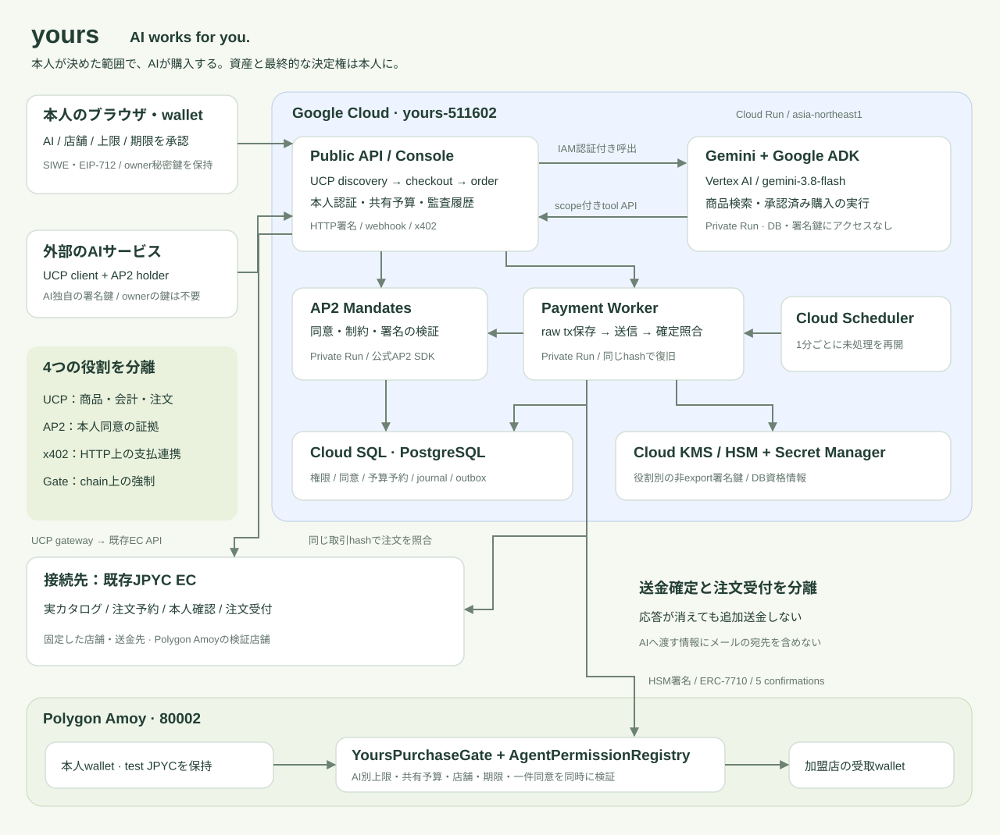

# yours

**AIは、あなたのために動く。**

AIに買い物を任せる。そのために、AIへ財布ごと渡す必要はありません。

yoursは、**本人のウォレットに資産を置いたまま、選んだAIへ購入権限を委任するプラットフォーム**です。ユーザーは「どのAIに・どの店舗で・いくらまで・いつまで」を指定します。Geminiや外部AIがUCPで購入を進め、スマートコントラクトが支払いの条件を強制します。

[公開アプリ](https://yours-api-110852561536.asia-northeast1.run.app) · [UCP discovery](https://yours-api-110852561536.asia-northeast1.run.app/.well-known/ucp) · [試用ガイド](docs/TRY-IT.md) · [外部AI client](examples/external-agent/README.md)

[第5回 Agentic AI Hackathon with Google Cloud](https://zenn.dev/hackathons/google-cloud-japan-ai-hackathon-vol5)向けプロジェクト。Google Cloud project: `yours-511602`。

## 解決する課題

買い物をAIへ任せるには、商品検索に加え、支出の制御と責任の追跡が必要です。複数のAIへそれぞれ5,000円を許可した結果、本人が考えていた総予算を超えてしまうこともあります。

yoursではAIごとの上限と、**すべてのAIが共有する予算**を同時に適用します。条件を超える注文は本人へ戻し、新しい本人署名がある場合だけ、その一件を許可します。AIを変更・追加しても使用済みの共有予算は引き継ぎます。

本人は一画面で権限・支払い・監査履歴を確認できます。AIサービスの開発者はAPI/SDKから接続し、ownerの秘密鍵を受け取らずに購入を実行できます。

## 実際にできること

- **Geminiに依頼** — Google ADKとVertex AIが実カタログを検索し、本人が署名した購入タスクをUCP/AP2/x402で実行します。
- **自分のAIを接続** — 外部AIのEVM実行アドレスとAP2公開鍵を登録。外部AI自身が注文に束縛された署名を作り、yoursが検証・送信します。
- **範囲を限定** — AI別・共有の1回上限と24時間予算、店舗、期限を設定。支出条件をLLMの判断だけに委ねません。
- **停止と一件承認** — サービス上の即時停止とchain上の失効に対応。予算超過等は新しい注文専用同意で一件だけ許可し、失効・改変・再利用は解除しません。
- **決済を追跡** — 送信前に署名済みtransactionを永続保存。応答消失時も同じhashを再照合し、二重払いを防ぎます。
- **既存ECで買う** — 独立したadapterで実店舗のカタログ・予約・本人確認・注文登録に接続。応答消失時は同じ取引hashで照合します。
- **購入品を受け取る** — yours Marketのデジタル商品は、本人の認証と決済確定後に実ファイルをダウンロードできます。

公開環境は**Polygon Amoy / test JPYC**を使用します。実通貨の決済サービスとして公開したものではありません。

## アーキテクチャ



| サービス | 役割 |
| --- | --- |
| Cloud Run · API / Console | 本人認証、AI接続、UCP API、x402、権限・注文の画面 |
| Cloud Run · Gemini agent | Google ADK + Vertex AI `gemini-3.8-flash`。実カタログと承認済みタスクのtoolだけを利用 |
| Cloud Run · AP2 authority | 公式AP2 SDKで本人同意・制約・署名を独立検証し、mandateとreceiptを発行 |
| Cloud Run · Payment worker | 条件検証、HSM署名、journal、送信・確定照合、outboxの処理 |
| Cloud SQL · PostgreSQL 16 | 権限、共有予算予約、同意、注文、transaction journal、監査履歴を永続化 |
| Cloud KMS / HSM | 役割ごとの非export署名鍵。Geminiサービスには署名鍵やDB secretへのアクセスを与えない |
| Cloud Scheduler | 非公開workerをIAM認証付きで定期実行し、処理中断から復旧 |
| Polygon Amoy | GateとRegistryが本人の支出条件を強制し、本人walletから店舗へ送金 |

公開するCloud RunはAPIだけです。内部サービスの呼び出しと鍵の使用は、専用サービスアカウントごとに限定しています。[IAMの範囲](infra/IAM.md)

## UCP・AP2・x402の役割

| 仕様 | yoursでの実装 |
| --- | --- |
| **UCP stable 2026-08-25** | discovery、商品検索、cart、checkout、fulfillment情報、order、HTTP署名、署名付きwebhook。公式schemaを固定して検証 |
| **AP2 v0.2** | 公式SDKによるopen/closed mandate、本人のEIP-712同意、holderの実署名、制約照合、決済receipt |
| **x402 v2** | HTTP 402の支払要求、`PAYMENT-SIGNATURE`、ERC-7710用payment handler、実chain receiptとの照合 |
| **EIP-7702 / ERC-7710** | MetaMaskの実装に委任した本人accountから、Gateだけが限定された委任を実行 |

AP2は本人同意の証拠、x402はHTTP上の支払連携です。UCPの採用だけで資産への支出権限が生まれることはありません。

UCP公式schemaとAP2 v0.2 SDKでは、delegated SD-JWTの表現に上流の不一致があります。yoursはUCP本体のschema検証と、AP2 SDKの暗号・制約検証を分けています。**全仕様・全payment handlerへの互換性を主張するものではありません。** 対応範囲と再現方法は[相互運用記録](docs/design/INTEROPERABILITY.md)、独自handlerは[決済仕様](docs/design/PAYMENT-HANDLER.md)を参照してください。

## 試す

1. [公開アプリ](https://yours-api-110852561536.asia-northeast1.run.app)を開き、Geminiへ「カタログの商品と価格を教えて」と入力します。検索はwallet接続なしで試せます。
2. 購入する場合はPC版MetaMaskでAmoyの本人walletを接続し、Geminiを追加します。
3. 予算・期限を指定して「ウォレットで承認する」を押します。未設定ならアプリからスマートアカウント設定を開始し、MetaMaskで確認します。
4. 「週次ふりかえりテンプレート」（300 test JPYC）を選び、その購入を任せる同意に署名します。
5. 支払履歴のtransactionと、確定後のダウンロードを確認します。

必要なtest JPYC・POL、承認の意味、キャンセル後の再開方法は[試用ガイド](docs/TRY-IT.md)にまとめています。秘密鍵やシードフレーズの入力は不要です。

## 検証と現在の範囲

| 実行場所 | 確認できた内容 |
| --- | --- |
| 公開Google Cloud | 4サービスの稼働、公開範囲、Cloud SQL、実HSM鍵とdiscoveryの一致、Gemini→既存ECを含む実カタログ検索 |
| 公開Amoy | yours専用Gate/Registryの配備、5 confirmations、code hash。本人walletのスマートアカウント設定を確認。AI登録・公開購入は確認中 |
| ローカルAnvil + PostgreSQL | 本人同意→公式AP2→UCP→x402→実ERC-7710送金→order/receipt、応答消失復旧、外部AI自身の署名、複数AI共有予算・外部client・本人限定の注文ページ・既存EC接続を含む68項目 |
| 実Chrome + 試験用EIP-1193 provider | 通常EOAの実EIP-7702設定、ERC-7715権限要求、承認後の通信失敗・部分登録・ウォレット再接続の復旧など22項目。実MetaMask拡張とは区別 |

[検証の証拠](docs/evidence/README.md) · [配備・実装記録](docs/IMPLEMENTATION.md) · [再現手順](docs/DEVELOPMENT.md)

独立したyours Marketに加え、既存ECの2店舗を接続するadapterを実装・配備しています。外部ECの対象は配送・variant・必須追加optionのないAmoy商品で、本人が予約へ同意したcheckoutを使います。公開Google CloudでGeminiによる実ECの検索、ローカルでHTTP fixtureと実Anvil送金を使った注文復旧を確認済みです。公開ECへの本人購入、返金処理は未完了です。[接続の範囲](docs/design/EC-ADAPTER.md)

## 開発

Node.js 22.14以上、pnpm 10.7.1、Foundry、Python 3.12、uv、PostgreSQL 16を使用します。

```sh
pnpm install --frozen-lockfile
pnpm build
pnpm typecheck
TEST_DATABASE_URL=postgresql://localhost/yours_test pnpm test
```

AP2のPython環境、公式MetaMask contractsを使う結合試験、Google Cloud配備は[開発手順](docs/DEVELOPMENT.md)を参照してください。

## 提出物

配備URL、構成図、試用手順、検証記録はこのREADMEから参照できます。[約3分のデモ構成](docs/DEMO-SCRIPT.md)を用意しています。動画の撮影・公開、ハッカソンDashboardのrepo連携・提出は未完了です。[要項との対応](docs/HACKATHON.md)

コードの由来と第三者ライブラリの帰属は[THIRD_PARTY_NOTICES.md](THIRD_PARTY_NOTICES.md)と[EXTRACTION.json](docs/EXTRACTION.json)に記録しています。
